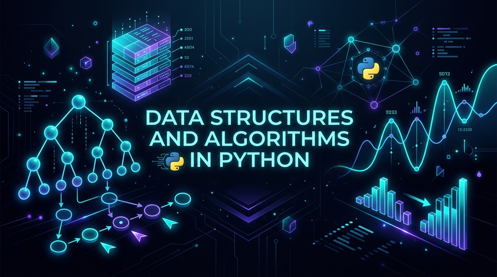

<p align="center">
  
</p>

<div align="center">

# 🚀 Complete Data Structures & Algorithms in Python

[](https://www.python.org/)
[](https://jupyter.org/)
[](LICENSE)
[](https://github.com/udityamerit/Complete-Data-Structure-Algorithms-In-Python)
[](http://makeapullrequest.com)
[](https://github.com/udityamerit/Complete-Data-Structure-Algorithms-In-Python/stargazers)

<p align="center">
  <b>A production-grade, pedagogically structured learning curriculum and coding reference for Data Structures, Core Algorithms, and Technical Interview Problem-Solving Patterns implemented in pure Python 3.</b>
</p>

[Architecture](#-repository-architecture) •
[Curriculum](#-curriculum--module-breakdown) •
[Complexity Cheat Sheet](#-big-o-complexity-cheat-sheet) •
[Code Highlights](#-featured-implementations--interview-patterns) •
[Quick Start](#-quick-start--setup) •
[Roadmap](#-future-roadmap) •
[Connect](#-author--connect)

</div>

---

## 📖 Overview

Mastering **Data Structures and Algorithms (DSA)** is the cornerstone of high-performance software engineering, algorithmic efficiency, and technical interview success.

This repository offers an intuitive, concept-first, and hands-on curriculum that builds every major data structure and algorithm from scratch in **Python 3**. Rather than treating data structures as black boxes, each module unpacks the underlying memory model, algorithmic trade-offs, edge-case safety, and asymptotic complexities ($O(1)$ to $O(2^N)$) across interactive **Jupyter Notebooks** and modular Python scripts.

### 🌟 Key Highlights

- 🧠 **Concept-First Pedagogy**: Begins with foundational Python mechanics (`*args`, `**kwargs`, references, in-place vs. out-of-place mutations) before introducing complex pointer architectures and hierarchical trees.
- ⚡ **Naive vs. Optimal Contrasts**: Directly contrasts naive solutions with optimized algorithms (e.g., $O(N^2)$ linked list construction vs. $O(N)$ tail-pointer construction; list-based queues vs. $O(1)$ linked-list queues).
- 🎯 **Interview-Ready Patterns**: Implements core technical interview patterns, including **Floyd's Tortoise and Hare Cycle Detection**, **In-Place Linked List Reversal**, **Breadth-First Level-Order Tree Ingestion**, and **Divide-and-Conquer Subsequence Generation**.
- 📓 **Interactive Visual Labs**: Experiment, run test fixtures, visualize pointer movements, and modify code cell-by-cell in Jupyter or VS Code.
- 📊 **Exhaustive Asymptotic Analysis**: Accompanied by Best, Average, and Worst-case time and space complexity evaluations.

---

## 🏗️ Repository Architecture

```text
Complete-Data-Structure-Algorithms-In-Python/
├── 01 Dictionaries/
│   └── Dictionary.ipynb          # Hash maps, frequency maps, collision merges, subset check
├── 02 Functions/
│   └── functions.ipynb           # *args, **kwargs, variable scoping, and in-place list reversals
├── 03 Searching And Sorting/
│   └── search sort.ipynb         # Binary Search O(log N), Bubble, Selection, Insertion Sort
├── 04 Recursion/
│   └── recursion.ipynb           # Inductive proofs, string subsequences, palindrome validation
├── 05 Linkedlist/
│   ├── LinkedList.ipynb          # Singly LL, O(N) builder, Floyd's cycle, in-place reversals
│   └── common.py                 # Reusable Node class and modular input helper utilities
├── 06 Stack/
│   └── stack.ipynb               # LIFO stack implementation with underflow/overflow safety
├── 07 Queue/
│   └── Queue.ipynb               # FIFO queues: Dynamic list vs. O(1) Linked List implementation
├── 08 Trees Generic Trees/
│   └── Generic Trees.ipynb       # N-ary Trees, BFS level-wise ingestion, height, traversals
├── 09 Binary Tree/
│   └── Binary Tree.ipynb         # Binary tree foundations, recursive traversals (In Progress)
├── assets/
│   └── banner.png                # Repository visual showcase banner
├── .gitignore                    # Python & Jupyter environment ignore rules
├── LICENSE                       # MIT Open Source License
└── README.md                     # Comprehensive project documentation
```

---

## 📑 Table of Contents

- [Overview](#-overview)
- [Repository Architecture](#-repository-architecture)
- [Curriculum & Module Breakdown](#-curriculum--module-breakdown)
  - [01. Dictionaries & Hash Maps](#01-dictionaries--hash-maps)
  - [02. Python Functions & Parameter Mastery](#02-python-functions--parameter-mastery)
  - [03. Searching & Sorting Algorithms](#03-searching--sorting-algorithms)
  - [04. Recursion & Mathematical Divide-and-Conquer](#04-recursion--mathematical-divide-and-conquer)
  - [05. Singly Linked Lists & Interview Patterns](#05-singly-linked-lists--interview-patterns)
  - [06. Stacks & LIFO Mechanics](#06-stacks--lifo-mechanics)
  - [07. Queues & FIFO Mechanics](#07-queues--fifo-mechanics)
  - [08. Generic Trees (N-ary Trees)](#08-generic-trees-n-ary-trees)
  - [09. Binary Trees & Hierarchical Structures](#09-binary-trees--hierarchical-structures)
- [Big-O Complexity Cheat Sheet](#-big-o-complexity-cheat-sheet)
- [Featured Implementations & Interview Patterns](#-featured-implementations--interview-patterns)
- [Quick Start & Setup](#-quick-start--setup)
- [Future Roadmap](#-future-roadmap)
- [Contributing](#-contributing)
- [Author & Connect](#-author--connect)
- [License](#-license)

---

## 📚 Curriculum & Module Breakdown

| Module | Core Domain | Key Concepts & Patterns Covered | Interactive Notebook / Code | Status |
| :---: | :--- | :--- | :--- | :---: |
| **01** | **[Dictionaries & Hash Maps](#01-dictionaries--hash-maps)** | Hash maps, $O(1)$ lookups, frequency tables, collision merging, dict comprehensions, subset matching | [`Dictionary.ipynb`](01%20Dictionaries/Dictionary.ipynb) |  |
| **02** | **[Functions & Parameter Mastery](#02-python-functions--parameter-mastery)** | Variable positional `*args`, keyword `**kwargs`, pass-by-object-reference, in-place list mutation | [`functions.ipynb`](02%20Functions/functions.ipynb) |  |
| **03** | **[Searching & Sorting](#03-searching--sorting-algorithms)** | Binary Search ($O(\log N)$), Bubble Sort, Selection Sort, Insertion Sort, array module vs lists | [`search sort.ipynb`](03%20Searching%20And%20Sorting/search%20sort.ipynb) |  |
| **04** | **[Recursion & Backtracking](#04-recursion--mathematical-divide-and-conquer)** | Mathematical induction, call-stack lifecycles, power calculation, string subsequences ($O(2^N)$), palindrome checking | [`recursion.ipynb`](04%20Recursion/recursion.ipynb) |  |
| **05** | **[Linked Lists](#05-singly-linked-lists--interview-patterns)** | Singly LL, $O(N)$ tail builder vs $O(N^2)$ naive input, Floyd's Cycle Detection, iterative & recursive reversals, palindrome list | [`LinkedList.ipynb`](05%20Linkedlist/LinkedList.ipynb), [`common.py`](05%20Linkedlist/common.py) |  |
| **06** | **[Stacks](#06-stacks--lifo-mechanics)** | Last-In-First-Out (LIFO), dynamic array implementation, push/pop/peek, underflow checks, size tracking | [`stack.ipynb`](06%20Stack/stack.ipynb) |  |
| **07** | **[Queues](#07-queues--fifo-mechanics)** | First-In-First-Out (FIFO), List-based Queue vs $O(1)$ Linked List Queue with tail pointer, enqueue/dequeue | [`Queue.ipynb`](07%20Queue/Queue.ipynb) |  |
| **08** | **[Generic Trees](#08-generic-trees-n-ary-trees)** | N-ary Tree Node, recursive input, level-wise BFS input with `deque`, tree height, node counting, node sum, traversals | [`Generic Trees.ipynb`](08%20Trees%20Generic%20Trees/Generic%20Trees.ipynb) |  |
| **09** | **[Binary Trees](#09-binary-trees--hierarchical-structures)** | Binary Tree node models, left/right subtrees, tree construction paradigms, recursive traversals | [`Binary Tree.ipynb`](09%20Binary%20Tree/Binary%20Tree.ipynb) |  |

---

### 01. Dictionaries & Hash Maps
> *Constant-time average lookups, key-value mappings, frequency tables, and dictionary transforms.*

- **Foundations & Mutation**: Instantiation (`{}`, `dict()`), safe lookups with fallback `.get(key, default)`, deletions (`del`, `.pop()`), and key/value views via `.keys()`, `.values()`, `.items()`.
- **Memory References & Aliasing**: Deep-dive into pointer aliasing (`dict1 = dict2`) vs. shallow cloning (`dict.copy()`).
- **Comprehensions**: Functional mapping and element filtering via dictionary comprehensions `{k: v for k, v in ...}`.
- **Algorithmic Patterns**:
  - Linear time $O(N)$ character and word frequency counting.
  - Merging multiple overlapping dictionaries with value aggregation (`merged[k] = merged.get(k, 0) + v`).
  - Merge two sorted lists into single structures.
  - Linear-time collection subset validation.

### 02. Python Functions & Parameter Mastery
> *Writing scalable, memory-efficient, and idiomatic Python algorithms.*

- **Dynamic Parameter Unpacking**: Variable-length positional arguments using `*args` (tuple packing/unpacking) and dynamic keyword arguments via `**kwargs` (dictionary packing/unpacking).
- **Object Reference Mechanics**: Python's call-by-object-reference paradigm—understanding when functions mutate arguments in-place (mutable types like `list`, `dict`) versus creating rebinding shadows.
- **In-Place Reversal Algorithms**: Designing algorithms that mutate lists without allocating auxiliary heap memory ($O(1)$ space).

### 03. Searching & Sorting Algorithms
> *Fundamental algorithmic paradigms for locating and ordering elements in linear containers.*

- **Searching**:
  - **Binary Search**: Logarithmic $O(\log N)$ search over sorted sequences through continuous boundary halving (`mid = (start + end) // 2`).
- **Elementary Comparison Sorts**:
  - **Bubble Sort**: Neighbor comparisons and bubbling passes with early termination ($O(N)$ best case, $O(N^2)$ worst case).
  - **Selection Sort**: Iterative minimum extraction and single swap per pass ($O(N^2)$ time, $O(1)$ space, unstable).
  - **Insertion Sort**: Online card-insertion paradigm with adaptive efficiency for nearly-sorted arrays ($O(N)$ best case, stable).

### 04. Recursion & Mathematical Divide-and-Conquer
> *Decomposing complex problem spaces into self-similar subproblems.*

- **The Inductive Principle**:
  1. **Base Case**: The non-recursive termination guard ensuring call-stack stability.
  2. **Induction Hypothesis**: Assuming correctness for smaller problem inputs ($f(n - 1)$ or $s[1:]$).
  3. **Induction Step**: Combining subproblem outputs to construct the final answer.
- **Core Problems & Call-Stack Analysis**:
  - Fast exponentiation calculation ($2^N$).
  - Cumulative natural summation ($f(n) = n + f(n - 1)$).
  - Recursive character filtering (`remove_char(s, ch)`).
  - Two-pointer recursive string palindrome validation (`polindrom(s)`).
  - Generating all string subsequences / power sets in $O(2^N)$ time and space.

### 05. Singly Linked Lists & Interview Patterns
> *Pointer-based linear chains, dynamic memory allocation, and classical interview questions.*

- **Node Architecture**: Custom `Node(data, next)` building block with forward references.
- **Construction Optimization**:
  - *Naive Builder*: Appending elements by re-traversing from head each time ($O(N^2)$ time bottleneck).
  - *Optimized Builder*: Maintaining an active `tail` pointer to append nodes in $O(1)$ time ($O(N)$ total time).
- **Core Operations**:
  - Linear traversal and pretty-printing (`10 -> 20 -> 30 -> None`).
  - Iterative length calculation.
  - Insertion: at head ($O(1)$), at tail ($O(1)$ with tail), at arbitrary index $k$ ($O(k)$).
  - Deletion: head node ($O(1)$), tail node ($O(N)$), index $k$ ($O(k)$), and value search deletion.
  - Modular shared utilities via [`common.py`](05%20Linkedlist/common.py).
- **Classical Interview Problems**:
  - **Floyd's Cycle-Finding Algorithm**: Detecting linked list cycles using Fast and Slow (Tortoise & Hare) pointers.
  - **In-Place Reversal (Iterative)**: Three-pointer linear reversal (`prev`, `curr`, `next_node`) with zero extra memory ($O(1)$ space).
  - **Recursive Reversal**: Reversing pointers during call-stack unwinding (both standard and optimized $O(N)$ variations).
  - **Palindrome Linked List**: Verification of symmetric linked list values.
  - **Duplicate Removal**: Removing duplicates from sorted linked lists in a single traversal pass.

### 06. Stacks & LIFO Mechanics
> *Last-In, First-Out (LIFO) discipline for state backtracking and syntax evaluation.*

- **Stack Specification**: `push(data)`, `pop()`, `top()` / `peek()`, `size()`, and `is_empty()`.
- **Implementation**: List-backed stack encapsulating state with runtime underflow prevention and size tracking.
- **Applications**: Reversal mechanics, expression validation, and call-stack modeling.

### 07. Queues & FIFO Mechanics
> *First-In, First-Out (FIFO) discipline for buffering, streaming, and breadth-first search.*

- **Queue Specification**: `enqueue(data)`, `dequeue()`, `front()`, `size()`, and `isEmpty()`.
- **Implementation Comparison**:
  - **List-Based Queue**: Simple dynamic array backing; however, `dequeue()` using `pop(0)` incurs an expensive $O(N)$ element shift overhead.
  - **Linked List-Based Queue (`QueueUsingLL`)**: Uses `head` (for $O(1)$ dequeue) and `tail` (for $O(1)$ enqueue) pointers, delivering true $O(1)$ performance across all operations.

### 08. Generic Trees (N-ary Trees)
> *Hierarchical non-linear structures with arbitrary branching factors.*

- **N-ary Tree Model**: `TreeNode(data)` with dynamic child arrays (`children = []`).
- **Tree Printing & Visualization**:
  - Standard DFS printing.
  - Structured hierarchical output (`parent: child1, child2, ...`).
- **Construction Strategies**:
  - **Recursive Ingestion**: Depth-first subtree construction with user prompt cascades.
  - **Level-Order Ingestion (`take_input_level_wise`)**: Breadth-first level-by-level tree generation using `collections.deque`.
- **Analytical Operations**:
  - Total node counting across subtrees (`count_tree_nodes(root)`).
  - Tree height computation ($1 + \max(\text{child heights})$).
  - Tree node summation (`sum_of_nodes(root)`).
- **Tree Traversals**:
  - **Preorder Traversal**: Visiting the root before traversing child subtrees.
  - **Postorder Traversal**: Traversing all child subtrees before visiting the root.

### 09. Binary Trees & Hierarchical Structures
> *Two-way branching hierarchical trees and binary search structures.*

- **Foundations**: Binary tree node anatomy (`data`, `left`, `right`).
- **Upcoming Modules**: Tree construction, DFS traversals (Inorder, Preorder, Postorder), BFS Level-Order traversal, Binary Search Tree (BST) operations, diameter, LCA, and balance checking.

---

## ⚡ Big-O Complexity Cheat Sheet

### Data Structure Operations

| Data Structure | Access (Avg) | Search (Avg) | Insertion (Avg) | Deletion (Avg) | Space (Worst) | Primary Strengths / Trade-offs |
| :--- | :---: | :---: | :---: | :---: | :---: | :--- |
| **Python List (Dynamic Array)** | $O(1)$ | $O(N)$ | $O(1)$ *(amortized)* | $O(N)$ | $O(N)$ | Instant indexed reads; slow mid/front insertions |
| **Singly Linked List** | $O(N)$ | $O(N)$ | $O(1)$ *(at head)* | $O(1)$ *(at head)* | $O(N)$ | Dynamic sizing; no contiguous memory needed |
| **Stack (Array / List)** | $O(N)$ | $O(N)$ | $O(1)$ *(push)* | $O(1)$ *(pop)* | $O(N)$ | Strictly controlled LIFO operations |
| **Queue (List-Based)** | $O(N)$ | $O(N)$ | $O(1)$ *(enqueue)* | $O(N)$ *(dequeue)* | $O(N)$ | Inefficient $O(N)$ dequeue due to array shifts |
| **Queue (Linked List)** | $O(N)$ | $O(N)$ | $O(1)$ *(enqueue)* | $O(1)$ *(dequeue)* | $O(N)$ | **Optimal FIFO**: True $O(1)$ push and pop |
| **Hash Map (Python Dict)** | $O(1)$ | $O(1)$ | $O(1)$ | $O(1)$ | $O(N)$ | Near-instant average operations; requires hashable keys |
| **Generic Tree (N-ary Tree)** | $O(N)$ | $O(N)$ | $O(1)$ *(append child)* | $O(N)$ | $O(N)$ | Hierarchical data modeling; traversal is $O(N)$ |

### Sorting & Searching Algorithms

| Algorithm | Best Time | Average Time | Worst Time | Space Complexity | Stable? | Algorithmic Paradigm |
| :--- | :---: | :---: | :---: | :---: | :---: | :--- |
| **Binary Search** | $O(1)$ | $O(\log N)$ | $O(\log N)$ | $O(1)$ | N/A | Decrease and Conquer (Sorted Array) |
| **Bubble Sort** | $O(N)$ | $O(N^2)$ | $O(N^2)$ | $O(1)$ | Yes | Comparison / Adjacent Swaps |
| **Selection Sort** | $O(N^2)$ | $O(N^2)$ | $O(N^2)$ | $O(1)$ | No | Incremental Minimum Selection |
| **Insertion Sort** | $O(N)$ | $O(N^2)$ | $O(N^2)$ | $O(1)$ | Yes | Incremental Online Insertion |

---

## 💡 Featured Implementations & Interview Patterns

### 1. Floyd's Cycle Detection Algorithm (Tortoise & Hare)
Detects cycles in a singly linked list in $O(N)$ time and $O(1)$ auxiliary space by leveraging relative pointer velocities:

```python
def has_cycle(head):
    """
    Determines whether a linked list contains a cycle using
    Floyd's Tortoise and Hare algorithm.
    Time Complexity: O(N) | Space Complexity: O(1)
    """
    slow = head
    fast = head

    while fast is not None and fast.next is not None:
        slow = slow.next          # 1 step
        fast = fast.next.next     # 2 steps

        if slow == fast:
            return True           # Pointers met -> Cycle exists

    return False                  # Fast reached null -> No cycle
```

### 2. Optimal $O(1)$ Queue using Singly Linked List
Eliminates Python's $O(N)$ list `.pop(0)` bottleneck by maintaining both `head` and `tail` pointers:

```python
class Node:
    def __init__(self, data):
        self.data = data
        self.next = None

class QueueUsingLL:
    """
    FIFO Queue backed by a singly linked list.
    Enqueue and Dequeue both operate in strictly O(1) time.
    """
    def __init__(self):
        self.head = None
        self.tail = None
        self.len = 0

    def size(self):
        return self.len

    def isEmpty(self):
        return self.len == 0

    def enqueue(self, data):
        new_node = Node(data)
        self.len += 1
        if self.head is None:
            self.head = new_node
            self.tail = new_node
        else:
            self.tail.next = new_node
            self.tail = new_node

    def dequeue(self):
        if self.isEmpty():
            print("Queue is Empty, cannot dequeue")
            return None
        self.len -= 1
        data = self.head.data
        self.head = self.head.next
        if self.head is None:
            self.tail = None
        return data
```

### 3. Level-Order Generic Tree Builder (BFS with `deque`)
Ingests hierarchical N-ary tree nodes level-by-level using a First-In-First-Out queue:

```python
from collections import deque

class TreeNode:
    def __init__(self, data):
        self.data = data
        self.children = []

def take_input_level_wise():
    """
    Constructs an N-ary tree level by level using Breadth-First Search (BFS).
    """
    data = int(input("Enter root node data: "))
    root = TreeNode(data)
    queue = deque([root])

    while queue:
        current_node = queue.popleft()
        num_children = int(input(f"Enter number of children for {current_node.data}: "))

        for i in range(num_children):
            child_data = int(input(f"Enter data for child {i + 1} of {current_node.data}: "))
            child_node = TreeNode(child_data)
            current_node.children.append(child_node)
            queue.append(child_node)

    return root
```

### 4. Optimized $O(N)$ Linked List Input Builder
Avoids the quadratic $O(N^2)$ traversal penalty by caching the tail pointer during dynamic ingestion:

```python
def linked_input_optimized():
    """
    Ingests node values until -1 sentinel is entered.
    Maintains a tail pointer to construct the list in O(N) total time.
    """
    value = int(input("Enter node value (-1 to stop): "))
    head = None
    tail = None

    while value != -1:
        new_node = Node(value)
        if head is None:
            head = new_node
            tail = new_node
        else:
            tail.next = new_node
            tail = new_node
        value = int(input("Enter node value (-1 to stop): "))

    return head
```

### 5. Recursive Subsequence Generation
Generates the power set ($2^N$ subsequences) of a string via pure divide-and-conquer:

```python
def subsequence(s):
    """
    Generates all 2^N subsequences of string s recursively.
    Time Complexity: O(2^N) | Space Complexity: O(2^N)
    """
    if s == "":
        return [""]

    small_ans = subsequence(s[1:])
    first_char = s[0]
    ans = []
    ans.extend(small_ans)

    for sub in small_ans:
        ans.append(first_char + sub)

    return ans
```

---

## 🚀 Quick Start & Setup

### Prerequisites

Ensure you have **Python 3.8+** installed on your workstation.

```bash
python --version
```

### 1. Clone the Repository

```bash
git clone https://github.com/udityamerit/Complete-Data-Structure-Algorithms-In-Python.git
cd Complete-Data-Structure-Algorithms-In-Python
```

### 2. Create a Virtual Environment (Recommended)

**On Windows (PowerShell):**
```powershell
python -m venv venv
.\venv\Scripts\Activate.ps1
```

**On macOS / Linux:**
```bash
python3 -m venv venv
source venv/bin/activate
```

### 3. Install Jupyter Dependencies

```bash
pip install --upgrade pip
pip install jupyter notebook ipykernel
```

### 4. Launch Jupyter Notebook or Lab

```bash
jupyter notebook
```

Navigate to any directory (`01 Dictionaries`, `05 Linkedlist`, `08 Trees Generic Trees`, etc.) and open `.ipynb` files to experiment interactively!

> **💡 VS Code Users**: You can open the project directly in [Visual Studio Code](https://code.visualstudio.com/) with the **Python** and **Jupyter** extensions installed to execute cells natively with rich variable inspection and step-debugging!

---

## 🗺️ Future Roadmap

- [x] **Module 01**: Dictionaries & Hash Map Mechanics
- [x] **Module 02**: Function Scopes, Dynamic Args & In-Place Mutations
- [x] **Module 03**: Searching & Elementary Sorting Algorithms
- [x] **Module 04**: Recursion & Mathematical Divide-and-Conquer
- [x] **Module 05**: Singly Linked Lists & Core Interview Patterns
- [x] **Module 06**: Stacks & LIFO Mechanics
- [x] **Module 07**: Queues (Array & $O(1)$ Linked List Implementations)
- [x] **Module 08**: Generic Trees (N-ary Trees, Level-Wise BFS & Traversals)
- [ ] **Module 09**: Binary Trees & Binary Search Trees (BST) *(In Progress)*
- [ ] **Module 10**: Priority Queues & Heaps (Min-Heap, Max-Heap, HeapSort)
- [ ] **Module 11**: Graph Algorithms (BFS, DFS, Dijkstra, Cycle Detection, Topological Sort)
- [ ] **Module 12**: Dynamic Programming (Memoization vs. Tabulation, 0/1 Knapsack, LCS, LIS)
- [ ] **Module 13**: Backtracking, Greedy Algorithms & Bit Manipulation

---

## 🤝 Contributing

Contributions, issues, and feature requests are welcome! Whether you are optimizing an algorithm, fixing typos, adding test cases, or providing detailed explanations:

1. **Fork** the repository.
2. **Create a Feature Branch**:
   ```bash
   git checkout -b feature/AddBinarySearchTree
   ```
3. **Commit your changes**:
   ```bash
   git commit -m "feat(trees): implement BST insertion and search methods"
   ```
4. **Push to the branch**:
   ```bash
   git push origin feature/AddBinarySearchTree
   ```
5. **Open a Pull Request** with a concise summary of your additions.

---

## 👨‍💻 Author & Connect

<div align="center">

### **Uditya Narayan Tiwari**

[](https://udityanarayantiwari.netlify.app/)
[](https://www.linkedin.com/in/uditya-narayan-tiwari-562332289/)
[](https://github.com/udityamerit)
[](mailto:uditmerit@gmail.com)

</div>

---

## 📄 License

This repository is distributed under the **MIT License**. See the [LICENSE](LICENSE) file for complete details.

<p align="center">
  <b>⭐ If you find this repository helpful for your DSA journey or interview preparation, please star this repo! ⭐</b>
</p>
